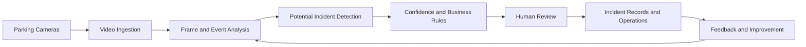
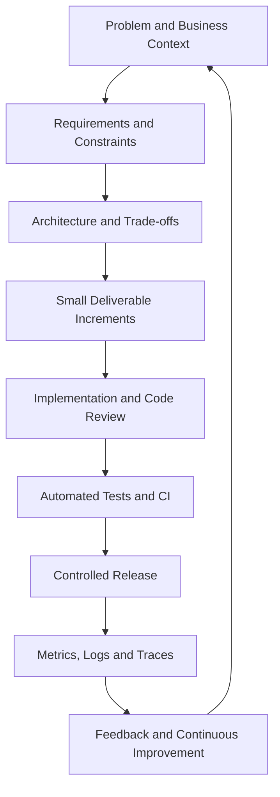

<h1 align="center">Mobin Rezaeifar</h1>

  <b>Tech Lead · Software Engineer · AI & Agentic Systems Builder</b>

  Building reliable software, capable engineering teams, and AI systems that interact with the real world.

  
  
  
  

  

Most of my recent work is part of active company projects, so public repositories do not represent the full scope of my engineering work.

## About Me

I'm a hands-on Tech Lead and Software Engineer working at the intersection of **software architecture, AI agents, computer vision, and engineering leadership**. I enjoy turning complex business problems into maintainable systems, connecting emerging AI capabilities to real products, and helping teams ship with confidence.

My work increasingly focuses on **agentic AI**: systems that do more than generate text. I'm interested in agents that use tools, interact with APIs, reason over context, coordinate multi-step workflows, and operate within clear reliability and security boundaries.

I have also worked on **camera-connected taxi projects**, including integration with cameras at taxi parking facilities for detecting potential collision incidents. That experience strengthened my interest in systems where software, video intelligence, and physical-world operations meet.

- **Engineering focus:** AI agents, system architecture, backend platforms, computer vision integration, and delivery engineering.
- **Leadership approach:** technical clarity, ownership, mentoring, practical trade-offs, and short feedback loops.
- **What I value:** reliable outcomes over hype, simple designs over unnecessary complexity, and measurable improvements over impressive-sounding technology.

## Selected Engineering Work

### AI Agents & Intelligent Automation

I work on moving AI from a chat interface into **tool-connected, task-oriented software**.

- Designing agent workflows with clear objectives, context, tool access, and execution boundaries.
- Integrating LLM-powered components with existing applications, backend services, and external APIs.
- Exploring orchestration patterns for multi-step tasks, tool calling, state management, and structured outputs.
- Treating evaluation, failure handling, observability, and human oversight as core engineering concerns.
- Combining probabilistic AI capabilities with deterministic services and business rules.

### Taxi Parking Camera Intelligence

A practical application of AI and software integration in taxi-related operations.

- Connected existing cameras in taxi parking areas to software workflows aimed at identifying possible collisions and incidents.
- Worked with the challenges of extracting useful event signals from real-world camera footage.
- Focused on the bridge between video analysis and actionable operational information, where reviewability and false-positive handling matter.
- Considered how camera inputs, event analysis, backend services, and human review fit together as one maintainable system.

**Reference architecture for this class of system:**

### Platform Engineering & Technical Leadership

Alongside AI-focused work, I build and improve the software foundations that allow teams to deliver consistently.

- Translating product goals into architecture, delivery plans, and engineering decisions.
- Building backend and frontend systems with an emphasis on reliability, maintainability, and security.
- Improving CI/CD, observability, incident response, and cross-team collaboration.
- Coaching engineers and making complex technical choices understandable to stakeholders.

## Outcomes I'm Proud Of

- Reduced commit-to-production lead time by **38%** while maintaining a change-failure rate below **9%** through safer release practices.
- Supported **4× traffic growth** in a customer-facing domain while reducing infrastructure costs by **28%** through architectural simplification.
- Improved incident response, reducing mean time to recovery from **3 hours to 25 minutes** with better alerts, runbooks, and reviews.
- Mentored **8 engineers**, contributing to **3 promotions** and **2 cross-team moves** through structured development and coaching.

## How I Approach AI Engineering

| Principle | What it means in practice |
| --- | --- |
| **Tools over theatrics** | Agents should complete useful tasks through well-defined tool and API integrations. |
| **Context is infrastructure** | Reliable behavior depends on the right data, state, retrieval, and boundaries. |
| **Human oversight by design** | Sensitive or uncertain actions need review, permissions, and escalation paths. |
| **Evaluate, don't assume** | Test task success, error patterns, and failure modes instead of relying on demos. |
| **Observable execution** | Make agent steps, decisions, errors, and costs inspectable. |
| **Production-minded systems** | Build for retries, timeouts, idempotency, data protection, and maintainability. |

## How I Lead

- **Clarity first:** document trade-offs, write concise RFCs/ADRs, and define what successful delivery looks like.
- **Small, reversible steps:** deliver working slices, gather feedback, and improve based on evidence.
- **Autonomy with alignment:** make goals and guardrails explicit while giving engineers ownership of solutions.
- **Operational excellence:** treat monitoring, security, release quality, and incident learning as part of product development.
- **People and systems together:** create an environment where engineers can challenge assumptions and do their best work.

## Engineering Delivery Loop

## Technical Toolkit

| Area | Technologies and practices |
| --- | --- |
| **AI & Agents** | LLM integration, agent orchestration, tool calling, context engineering, structured outputs, workflow automation, evaluation, human-in-the-loop design |
| **Computer Vision & Video Systems** | Camera integration, video ingestion concepts, event-oriented analysis, collision/incident detection workflows |
| **Architecture** | Domain-Driven Design, Event-Driven Architecture, Microservices, Micro-Frontends, Clean Architecture, CQRS, Hexagonal/Onion Architecture |
| **Backend** | .NET, Node.js, Kafka, RabbitMQ, API design |
| **Frontend** | React, Next.js, Svelte, Micro-Frontend orchestration |
| **Data** | PostgreSQL, Redis, MongoDB, SQL |
| **DevOps & Infrastructure** | Docker, Docker Swarm, Kubernetes, Helm, GitHub Actions, Argo CD, Terraform |
| **Quality Engineering** | Unit, Integration, E2E and Contract Testing, TDD/BDD, Jest, Mocha, xUnit, Cypress, Playwright |
| **Observability** | Prometheus, Grafana, OpenTelemetry, SLIs/SLOs, incident management |
| **Security** | OWASP, IAM, secrets management, Vault/KMS, threat modeling, Zero Trust principles |

## Working With Me

I prefer teams that share context early, write down significant decisions, and take ownership of the complete delivery lifecycle. I favor practical experimentation without sacrificing engineering discipline: **build, verify, observe, learn, improve**.

I'm especially interested in projects that combine **AI agents with operational software, real-world data, video systems, and scalable backend architecture**.

## Contact

- **LinkedIn:** [linkedin.com/in/mbnrz](https://www.linkedin.com/in/mbnrz)
- **dev.to:** [dev.to/mobinrezaeifar](https://dev.to/mobinrezaeifar)
- **Stack Overflow:** [stackoverflow.com/users/21860347](https://stackoverflow.com/users/21860347)
- **Email:** [mobinrezaeifar@gmail.com](mailto:mobinrezaeifar@gmail.com)

  
GitHub activity

  

    
    
  

  

    
  

