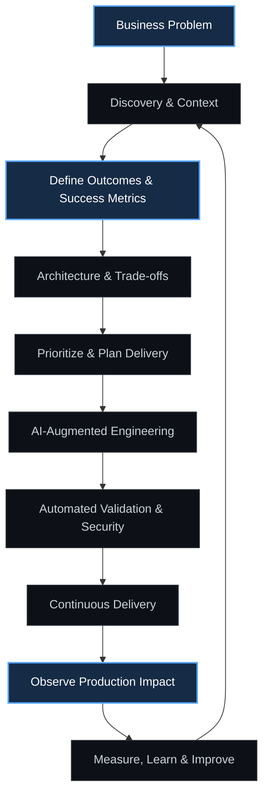

<h1 align="center">Mobin Rezaeifar</h1>

  <strong>Tech Lead · Software Engineer · Engineering Leadership</strong>

  Turning complex business challenges into reliable, scalable software products.

  
  
  
  

  

  

---

## About Me

I'm a **Tech Lead and Software Engineer** focused on solving meaningful business problems through thoughtful engineering, effective leadership, and pragmatic technical decisions.

I work at the intersection of **product strategy, software architecture, engineering execution, and team development**.

My goal isn't simply to deliver code. It's to build systems that create measurable value, remain maintainable as businesses evolve, and enable engineering teams to move confidently.

I believe great engineering starts with understanding the problem, not choosing the technology.

**What drives my work:**

- **Business Impact:** Connect engineering decisions to measurable product and business outcomes.
- **Systems Thinking:** Design for maintainability, reliability, scalability, and long-term evolution.
- **Engineering Leadership:** Build alignment, ownership, and environments where engineers can do their best work.
- **Pragmatic Architecture:** Make deliberate trade-offs and avoid complexity without clear value.
- **AI-Augmented Engineering:** Use AI to accelerate delivery, exploration, testing, and automation while maintaining human accountability.
- **Continuous Improvement:** Improve delivery systems through feedback, measurement, and experimentation.

## Selected Engineering Impact

| Area | Outcome |
|:---|:---|
| Delivery Performance | Reduced commit-to-production lead time by **38%** |
| Release Reliability | Maintained a change failure rate below **9%** |
| Scalability | Supported **4× traffic growth** in a customer-facing domain |
| Infrastructure Efficiency | Reduced infrastructure costs by **28%** through architectural simplification |
| Incident Response | Reduced MTTR from **3 hours to 25 minutes** |
| Engineering Growth | Mentored **8 engineers**, contributing to **3 promotions** and **2 cross-team moves** |

These outcomes reflect a focus on balancing delivery speed, system reliability, operational efficiency, and team development.

## How I Approach Engineering

### 01. Understand the Problem Before Building the Solution

Engineering begins with identifying the actual problem, understanding business constraints, and defining what success looks like.

I prioritize:

- Business and technical discovery
- Requirements clarification and domain modeling
- Stakeholder alignment
- Risk identification and feasibility analysis
- Measurable success criteria

### 02. Make Architecture Serve the Product

Architecture should enable a business to evolve rather than restrict it.

My approach emphasizes:

- Domain boundaries and clear ownership
- Appropriate architectural patterns
- Explicit technical trade-offs
- Incremental evolution over unnecessary rewrites
- Reliability, security, and maintainability by design
- Sustainable technical decisions

I prefer the simplest architecture that satisfies current requirements while preserving reasonable options for future growth.

### 03. Build for Delivery, Not Just Development

Writing software is only one part of delivering a successful product.

I focus on:

- Short feedback loops
- Small, reversible changes
- Continuous integration and delivery
- Automated quality assurance
- Production observability
- Clear operational ownership
- Measurable delivery performance

The objective is to move from an idea to validated production value with minimal unnecessary friction.

### 04. Lead Through Clarity and Ownership

Strong engineering teams need context, autonomy, trust, and clear expectations.

My leadership principles include:

- Communicate the "why" before discussing the "how".
- Make decisions and trade-offs transparent.
- Encourage ownership instead of dependency.
- Use RFCs and ADRs to preserve decision context.
- Create space for mentoring and technical growth.
- Treat incidents as opportunities for systemic learning.
- Measure team effectiveness through outcomes, not activity.

### 05. Treat AI as an Engineering Multiplier

AI is changing how software is designed, implemented, tested, and maintained.

I believe engineering value increasingly comes from the ability to define the right problems, establish architectural direction, orchestrate tools, and validate results.

My approach to AI-assisted engineering emphasizes:

- AI-assisted problem exploration and solution design
- Accelerated implementation and refactoring
- Automated testing and quality analysis
- Agent-assisted development workflows
- Human review of architecture and critical decisions
- Security, correctness, and maintainability validation
- Responsible automation with clear accountability

**AI can accelerate implementation. Engineering judgment determines whether the result is worth shipping.**

## My Engineering Operating Model

## Engineering Principles

| Principle | How I Apply It |
|:---|:---|
| Outcomes Over Output | Measure delivered value rather than lines of code or completed tasks |
| Simplicity Over Complexity | Introduce complexity only when its benefits justify the cost |
| Clarity Over Cleverness | Favor understandable solutions and explicit decisions |
| Ownership Over Handoffs | Encourage end-to-end responsibility for product and system health |
| Evidence Over Assumptions | Use metrics, experimentation, and production feedback |
| Automation Over Repetition | Automate predictable work to create space for higher-value engineering |
| Evolution Over Perfection | Deliver incrementally and refine based on real-world feedback |
| Security by Design | Consider security and reliability throughout the development lifecycle |
| People Over Process | Use processes to support engineers, not constrain them |

## Areas of Focus

**Software Architecture & System Design**

Domain-driven design, distributed systems, event-driven architecture, system integration, scalability, architectural governance, and technical decision-making.

**Engineering Leadership & Execution**

Technical strategy, engineering planning, cross-functional collaboration, mentoring, code quality, delivery optimization, and organizational alignment.

**Platform Engineering & Reliability**

Infrastructure automation, continuous delivery, observability, incident management, performance engineering, and operational resilience.

**AI-Assisted Software Engineering**

AI-augmented development workflows, engineering automation, agent-oriented tooling, code review, testing, and human-in-the-loop validation.

**Product & Business Alignment**

Problem discovery, technical feasibility, product-oriented decision-making, cost optimization, and outcome-driven delivery.

## Technical Foundation

Technology is a means of solving problems, not the starting point of my engineering decisions.

My technical background includes:

| Domain | Technologies & Practices |
|:---|:---|
| Architecture | DDD, EDA, Microservices, Micro-Frontends, Clean Architecture, CQRS, Hexagonal Architecture, Onion Architecture |
| Backend | .NET, Node.js, Kafka, RabbitMQ |
| Frontend | React, Next.js, Svelte, Micro-Frontend Architecture |
| Data & Storage | PostgreSQL, MongoDB, Redis, SQL |
| Infrastructure | Docker, Docker Swarm, Kubernetes, Helm, Terraform |
| Delivery | GitHub Actions, Argo CD, CI/CD, Infrastructure as Code |
| Quality Engineering | Unit, Integration, E2E, Contract Testing, TDD, BDD |
| Testing Tools | Jest, Mocha, xUnit, Cypress, Playwright |
| Observability | Prometheus, Grafana, OpenTelemetry, SLOs, SLAs |
| Security | OWASP, IAM, Vault, KMS, Threat Modeling, Zero Trust |

I select technologies based on system requirements, team capabilities, operational constraints, and long-term ownership costs.

## Working With Me

I work best in environments where engineering is treated as a partner in creating business value.

You can expect:

- **Clear communication:** Goals, constraints, risks, and technical decisions are made explicit.
- **Structured decision-making:** Architecture is guided by evidence, trade-offs, and business context.
- **Practical execution:** Priorities are translated into deliverable increments with observable results.
- **Engineering accountability:** Reliability, security, and maintainability are part of delivery.
- **Collaborative leadership:** Engineers are trusted to contribute ideas, challenge assumptions, and own solutions.
- **Continuous learning:** Feedback from production, users, and teams informs future decisions.

## Current Work

Most of my engineering contributions are made through private, production-facing company repositories.

My work is primarily focused on software architecture, engineering leadership, scalable systems, platform reliability, and delivering business-oriented software products.

Public repository activity represents only a portion of my engineering work.

## Let's Connect

I'm interested in conversations around software architecture, engineering leadership, AI-assisted development, platform engineering, and building products that solve real problems.

  
  
  
  

---

  <strong>Understand the problem. Design with purpose. Deliver measurable value.</strong>

  Good engineering is not defined by the technologies we use, but by the problems we solve and the impact we create.

