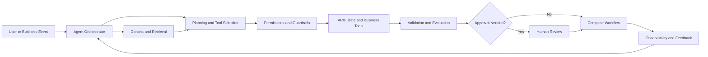
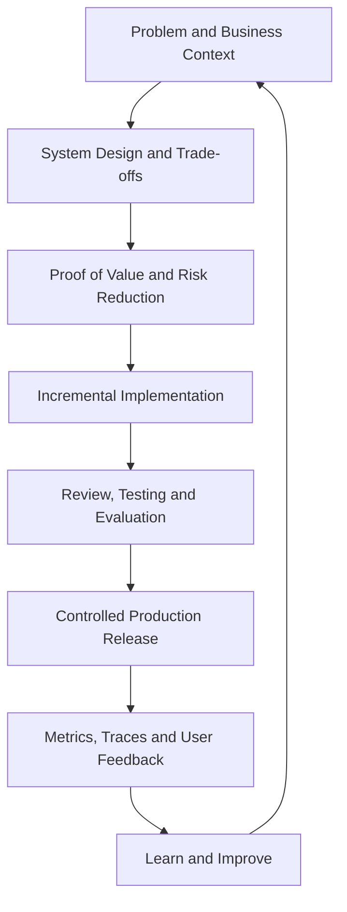

<h1 align="center">Mobin Rezaeifar</h1>

  <strong>AI Systems Architect · Tech Lead · Hands-on Software Engineer</strong>

  I design intelligent systems, build the software behind them, and lead the teams that take them to production.

  
  
  
  

  
  
  
  
  

  

Much of my work is developed within active company projects and private repositories. Public GitHub activity shows only a small part of what I build.

---

## Beyond the Stack

I'm a **hands-on technical leader** working across **AI engineering, software architecture, computer vision, distributed platforms, and product delivery**. I enjoy the entire lifecycle: understanding an operational problem, defining its architecture, implementing the difficult pieces, shipping safely, and improving the system with real feedback.

AI has become a central part of how I design and build software. My focus is not limited to model APIs or chat interfaces. I work on **agentic systems** that combine language models, tools, data, software services, and controlled execution to get meaningful work done.

One example is integrating **existing cameras in taxi parking environments** into software workflows for identifying potential collision events. That is one illustration of the larger class of problems I enjoy: turning signals from the physical world into useful, reviewable actions inside operational software.

I work at two levels simultaneously:

- **As an engineer:** I design architectures, write code, integrate systems, investigate failures, and solve complex implementation problems.
- **As a technical leader:** I shape engineering direction, align technical decisions with business needs, mentor developers, and build delivery practices that help teams move confidently.

## What I Build

| Domain | Engineering focus |
| :--- | :--- |
| **Agentic AI & Intelligent Automation** | Tool-using agents, multi-step orchestration, multi-agent patterns, contextual workflows, AI-assisted operations, and application integration |
| **Computer Vision & Video Intelligence** | Camera-to-software integration, video ingestion, event detection workflows, incident triage, evidence review, and operational alerts |
| **Operational & Mobility Systems** | Real-world business processes, transportation-related workflows, event-driven services, integrations, and operational visibility |
| **Enterprise & Product Platforms** | Backend services, business applications, ERP/CRM-style workflows, data-intensive systems, and customer-facing products |
| **Cloud & Distributed Architecture** | Service boundaries, messaging, observability, security, infrastructure automation, and scalable deployment practices |
| **Engineering Leadership** | Technical strategy, architecture decisions, hands-on execution, code quality, developer enablement, and iterative delivery |

## AI Engineering: From Models to Actions

I approach AI as a software engineering discipline. The difficult work starts after a model gives a convincing answer: the system still needs to access the right data, execute the right tools, recover from failures, enforce permissions, and prove that the task was completed correctly.

### Capabilities I Focus On

- **Agent orchestration:** task decomposition, multi-step execution, agent collaboration patterns, routing, and stateful workflows.
- **Tool and system integration:** function calling, API-connected agents, MCP-style tool interfaces, database access, and business-system automation.
- **Context engineering:** retrieval-augmented generation, memory strategies, grounding, structured context, and knowledge integration.
- **Multimodal workflows:** combining text, images, video-related signals, and structured operational data.
- **Reliability and evaluation:** testable outputs, tracing, fallbacks, retries, failure analysis, and human review where needed.
- **Safe execution:** permissions, bounded tool access, secrets handling, auditability, and approval steps for consequential actions.
- **AI-assisted engineering:** using advanced AI tooling throughout software design, coding, debugging, testing, review, and documentation.

### A Reference Pattern for Production Agents

The objective is **dependable task completion**, not simply impressive model output.

## Computer Vision Meets Operational Software

Connecting cameras to software creates a different class of engineering challenges: imperfect footage, continuous streams, uncertain classifications, event timing, operational noise, and the need for human-verifiable outcomes.

My taxi-parking collision-detection work is one example of integrating visual inputs with an operational process. The broader design approach applies to many camera-connected environments where meaningful events need to be surfaced and reviewed.

I care about what happens **after detection**: whether an event is actionable, how operators can review it, how systems avoid unnecessary escalation, and how the workflow remains maintainable as complexity grows.

## The Engineering Problems I Enjoy

**Building useful agents.** Connecting models to real products and tools, with the safeguards and execution logic that make automation practical.

**Turning messy inputs into reliable workflows.** Bridging cameras, external services, operational events, data stores, and human decisions.

**Making complex architectures simpler.** Finding the right boundaries, reducing unnecessary coupling, and designing systems teams can evolve.

**Shipping without losing control.** Improving automated testing, release discipline, observability, incident handling, and secure defaults.

**Developing engineers while delivering software.** Pairing hands-on technical work with mentoring, decision clarity, and ownership.

## Engineering Impact

I measure engineering work by **outcomes, not technology counts**. The metrics I care about include lead time, deployment reliability, recovery time, system capacity, operational cost, model-task success, and how effectively a team can maintain what it ships.

<strong>Example impact scorecard for a public portfolio</strong>

The following figures are **illustrative presentation examples, not verified claims about my work**. They should be replaced with confirmed project data before being presented as personal achievements.

| Example metric | Illustrative figure | How it would be measured |
| :--- | ---: | :--- |
| Faster commit-to-production delivery | **38%** | Median lead-time comparison across release windows |
| Higher supported platform traffic | **4×** | Sustained throughput under defined reliability targets |
| Reduced infrastructure spending | **28%** | Comparable monthly infrastructure cost before and after changes |
| Faster incident recovery | **3h → 25m** | Median mean time to recovery across comparable incidents |
| Engineers supported through mentoring | **8** | Documented mentorship and development activity |

In real projects, I prioritize improvements that can be explained through a baseline, a deliberate technical change, and an observable result.

## How I Lead and Deliver

- **Stay hands-on:** leadership should remain close enough to the code and architecture to understand difficult trade-offs.
- **Make decisions legible:** use concise technical proposals, ADRs, explicit constraints, and defined success criteria.
- **Build small, learn quickly:** deliver thin vertical slices, validate assumptions, and prefer reversible changes.
- **Keep AI accountable:** design evaluations and oversight into agent workflows rather than adding them at the end.
- **Engineer for operations:** instrumentation, alerts, incident response, and security belong in the initial design.
- **Scale people, not just software:** share context, create ownership, support mentorship, and avoid unnecessary process.

### My Delivery Loop

## Technical Landscape

The technologies below describe areas in my engineering toolkit. I choose tools based on system constraints rather than treating a stack as an identity.

| Discipline | Technologies and practices |
| :--- | :--- |
| **AI & Agent Systems** | LLM integration, agent orchestration, tool/function calling, MCP concepts, RAG, context engineering, structured outputs, evaluation, human-in-the-loop workflows |
| **Architecture** | Domain-Driven Design, Clean Architecture, Event-Driven Architecture, CQRS, Hexagonal/Onion Architecture, microservices, micro-frontends |
| **Backend** | .NET, C#, Node.js, API design, Kafka, RabbitMQ |
| **Frontend** | React, Next.js, Svelte, component-driven architecture |
| **Data** | PostgreSQL, MongoDB, Redis, SQL, data modeling and caching |
| **Infrastructure** | Docker, Docker Swarm, Kubernetes, Helm, GitHub Actions, Argo CD, Terraform |
| **Quality** | Unit, integration, end-to-end and contract testing, xUnit, Jest, Mocha, Cypress, Playwright, TDD/BDD |
| **Observability** | OpenTelemetry, Prometheus, Grafana, logging, tracing, SLOs, incident response |
| **Security** | OWASP, IAM, secrets management, Vault/KMS concepts, threat modeling, Zero Trust principles |
| **Real-World Systems** | Camera integration, video pipelines, event processing, operational alerts, reviewable incident workflows |

## Currently Interested In

- AI-native products in which agents can operate across real business workflows.
- More reliable multimodal and computer-vision-assisted operational systems.
- Better evaluation and observability for tool-using AI agents.
- Software architectures that keep the power of automation without sacrificing control.
- Engineering organizations where technical depth and leadership reinforce one another.

## Let's Connect

I enjoy conversations about **agentic AI, intelligent systems, difficult architecture decisions, platform engineering, and building software that solves operational problems**.

- **LinkedIn:** [linkedin.com/in/mbnrz](https://www.linkedin.com/in/mbnrz)
- **dev.to:** [dev.to/mobinrezaeifar](https://dev.to/mobinrezaeifar)
- **Stack Overflow:** [stackoverflow.com/users/21860347](https://stackoverflow.com/users/21860347)
- **Email:** [mobinrezaeifar@gmail.com](mailto:mobinrezaeifar@gmail.com)

<strong>GitHub activity</strong>

  
  

  

